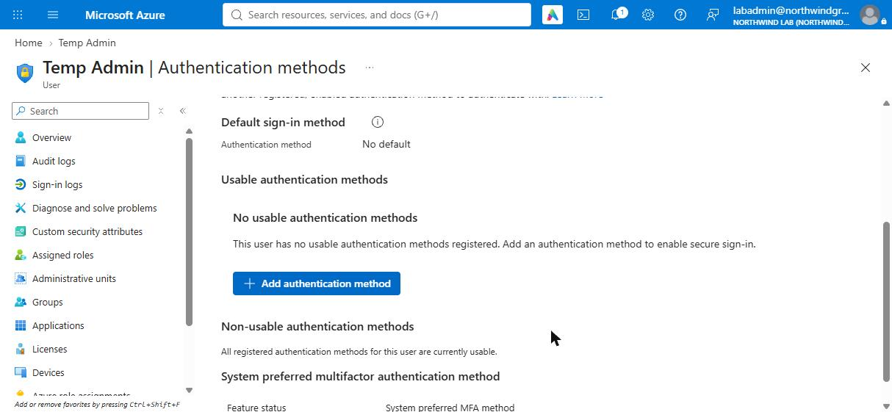
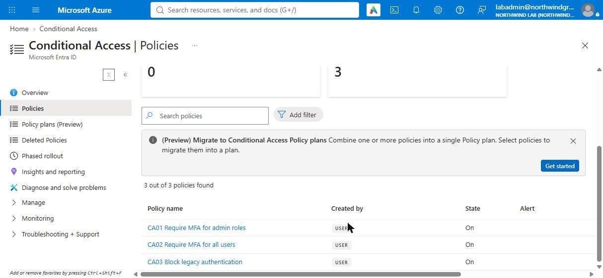
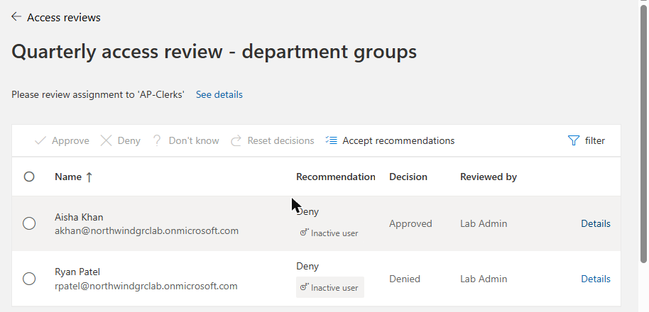
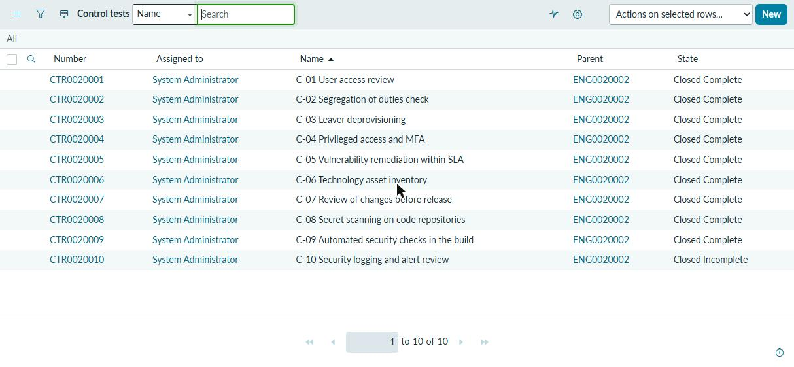
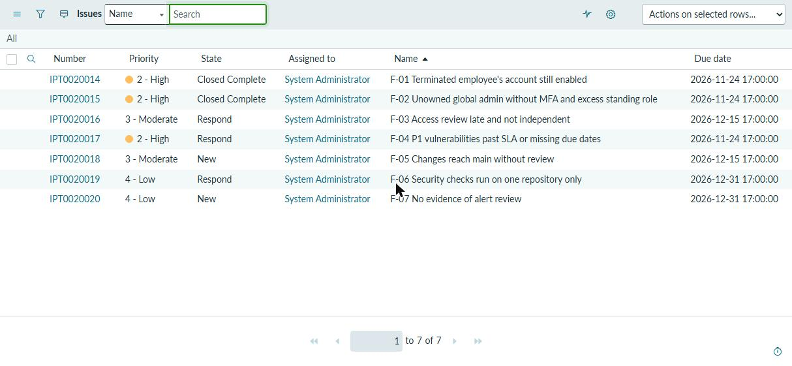

# it-controls-assurance-lab

I built this to practise how a second line IT risk team tests controls from start to finish. Using a simulated company (Northwind) and my other lab projects, I picked 10 information risk controls, mapped them to NIST CSF 2.0, ISO 27001:2022 and OSFI B-13, and ran each one through a walkthrough, a test of design and a test of operating effectiveness on real evidence. Failed controls became findings with a root cause, owner and due date. I fixed the high risk ones and retested.

The testing is in [reports/workpaper.xlsx](reports/workpaper.xlsx) and the write up is [reports/findings-report.pdf](reports/findings-report.pdf). I also loaded the engagement (ENG0020002), the control tests and the issues into a ServiceNow developer instance using Policy and Compliance Management and Audit Management.

## Scope and evidence
The evidence comes from systems I actually run:
- Northwind's Entra ID tenant. setup_tenant.py creates the staff, department groups and directory roles, seeded with common control gaps: a leaver who is still enabled, an IT support analyst who kept User Administrator after a migration, and a global admin set up "for later" that never registered MFA.
- My other repos (cve-triage, access-governance-lab, splunk-detections, traffic-analysis) for change review, secret scanning and CI security checks.
- The VULN project in Jira from cve-triage for the P1 remediation SLA.
- The Salesforce SoD lab from access-governance-lab.

control_matrix.csv has the 10 controls with the risk, owner, frequency, evidence and framework mapping. test_results.csv has the walkthrough, design test and operating test for each control, findings.csv has the 7 findings and retest.csv tracks the fixes.

## Running it
The Entra scripts call Microsoft Graph through `az rest`, using the `az login` session, so there's no client secret anywhere.

```
az login --tenant <your tenant>.onmicrosoft.com --allow-no-subscriptions
export LAB_DOMAIN=<your tenant>.onmicrosoft.com
python setup_tenant.py
python entra_evidence.py
python collect_evidence.py
python build_workpaper.py
```

collect_evidence.py needs the gh CLI logged in. Don't run setup_tenant.py again after the fixes, it puts the seeded roles back.

The fixes and the retest:

```
python remediate_tenant.py
python remediate_tenant.py --apply
python conditional_access.py --apply
python entra_evidence.py --out evidence/retest
python collect_evidence.py --out evidence/retest --settings-only
python build_workpaper.py
```

Without --apply both scripts only print what they would change, and running them a second time changes nothing.

Tests (no tenant needed):

```
pip install -r requirements.txt
python -m unittest test_graph
```

## Sample run
```
$ python collect_evidence.py
cve-triage: 102 commits on the default branch, sampled 10
access-governance-lab: 25 commits on the default branch, sampled 10
splunk-detections: 11 commits on the default branch, sampled 10
traffic-analysis: 10 commits on the default branch, sampled 10
wrote evidence

$ python remediate_tenant.py
disable rpatel (left 2026-09-30, HR-1057)
disable tempadmin
remove Global Administrator from tempadmin
remove standing User Administrator from jwalsh

$ python entra_evidence.py --out evidence/retest
8 users, 1 role assignments
```

## Results
3 of the 10 controls operated effectively: the SoD check (C-02), the asset inventory (C-06) and secret scanning (C-08). The other 7 have findings:
- F-01 High: rpatel could still sign in 48 days after their last day.
- F-02 High: tempadmin held standing Global Administrator with no owner and no MFA, and jwalsh kept User Administrator after a migration.
- F-03 Medium: the Q3 access review was signed off late, two people approved their own access and rpatel was approved after leaving.
- F-04 High: two P1 tickets went past the 7 day SLA and three had no due date.
- F-05 Medium: 0 of 40 sampled commits went through a reviewed pull request and no repo has branch protection.
- F-06 Low: only cve-triage runs CI security checks and Dependabot security updates were off on all four repos.
- F-07 Low: there's no record that the Splunk alerts are reviewed.

What was fixed is in retest.csv. F-01 and F-02 are closed: rpatel and tempadmin are disabled, jwalsh has no standing role and gets Helpdesk Administrator as an eligible role in PIM (4 hours max, MFA, a reason and a ticket to activate), and three Conditional Access policies require MFA and block legacy sign-in. F-03 is fixed with a quarterly Entra access review where the reviewer is the Access Governance Lead, not the person's own manager. Its first run denied both leavers. F-04 and F-06 are partly fixed. Turning on Dependabot also added GitHub's Dependency Graph workflow to cve-triage, the only repo with a requirements.txt, which is why its workflow count went from 1 to 2.

tempadmin before the fix, a Global Administrator with no MFA method:



The Conditional Access policies after the fix, and the first access review on AP-Clerks:




The control tests and issues in ServiceNow:




## Design notes
The tenant started on Entra ID Free, which is what the testing ran on. PIM, Conditional Access and Access Reviews need P1/P2, so I turned on the Entra ID P2 trial for the fixes. That's why the before evidence has no MFA or sign-in columns and the retest evidence does.

I used the az CLI instead of an app registration with a client secret. There's no secret to store, and the evidence is pulled as whoever is doing the testing. The downside is the CLI's token can't write PIM or access reviews, so those were set up in the portal.

Small populations were tested in full (2 leavers, 3 role holders, 11 P1 tickets). Only the commit history was big enough to sample, so collect_evidence.py picks 10 commits per repo with a fixed seed and anyone can rerun it and get the same 40.

My repos have one maintainer, so C-07 was always going to fail. I recorded what's actually there.

The work paper is built from the CSVs so the spreadsheet can't drift from the evidence.

## Rough edges
- last_sign_in shows "never" for every account in the retest, including labadmin. Sign-in activity takes a while to show up after a P2 trial starts, so it needs another pull before it can be used as evidence. The MFA registration report was still empty for the same reason.
- graph.py calls the CLI's bundled python on Windows because az.cmd breaks URLs with & in them. A change to how the CLI is installed would break this.
- Access review results only apply when the review closes, so the leavers' group memberships come off a few days after the decisions.
- Nothing checks the ServiceNow records against the CSVs, so an edit to findings.csv has to be copied to ServiceNow by hand.
